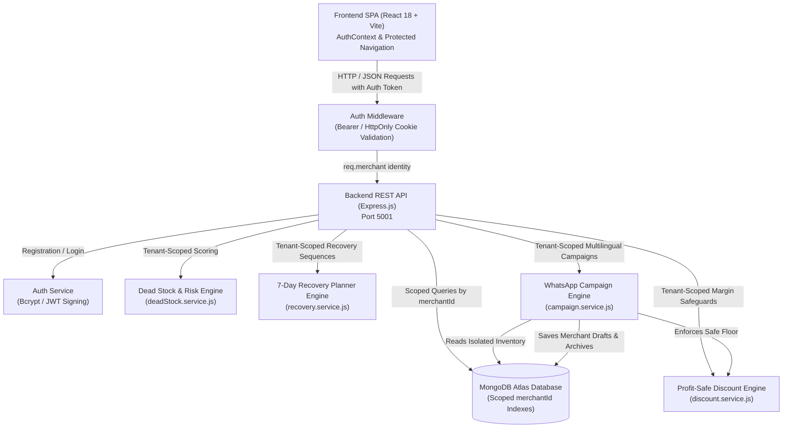

# Architecture Overview — StockSaathi AI

## System Purpose
StockSaathi AI is an AI-powered dead stock recovery platform tailored for small retailers.
**Tagline:** *Recover Cash. Protect Profit. Grow Smarter.*

## Architectural Principles (Phase 1–7)
1. **Decoupled Architecture:** The frontend (React + Vite SPA) and backend (Express REST API) are completely independent and independently runnable services.
2. **Standardized Contract:** Communication occurs over clean HTTP/JSON REST endpoints (`/api/*`).
3. **Strict Technology Adherence:**
   - **Frontend:** React 18, Vite, JavaScript (JSX), Tailwind CSS, Lucide React, Recharts, React Router.
   - **Backend:** Node.js, Express.js, Mongoose 8.
   - **Database:** MongoDB Atlas with Mongoose connection pooling and live readyState tracking.
4. **Deterministic Analysis Engine (Phase 6):**
   - Pure, rule-based classification based on verified stock age and transaction timestamps.
   - No black-box machine learning or hallucinated data.
   - Distinct separation between stock age, risk score, and financial exposure.
5. **Profit-Safe Dynamic Discount Optimization Engine (Phase 7):**
   - Deterministic mathematical margin floors to guarantee clearance markdowns never trigger unmonitored loss.
   - Formula: Target Margin Minimum Price $P_{\min} = (C + V) / (1 - M)$, Target Profit Floor $P_{\min} = C + V + G$.
   - Max Safe Discount %: $\max(0, \min(100, (1 - P_{\min} / P) \times 100))$.
   - AI recommendations based on Phase 6 dead stock severity, remaining stock quantity, and near-expiry urgency.
7. **7-Day Dead Stock Recovery Action Planner (Phase 8):**
   - Practical 7-day liquidation sequence generated directly from verified MongoDB inventory records.
   - Intelligent prioritization combining Phase 6 risk classifications (Critical Dead Stock > At Risk > Slow Moving) and capital exposure.
   - Direct integration with Phase 7 profit-safe price floors ($P_{\min}$): clearance selling prices can never breach configured margin/profit constraints.
   - Non-discount fallback mechanism: when safe discount capacity is 0%, the planner assigns merchandising display, bundle pairing, or audit actions.
   - Safe plan regeneration policy: completed actions and retailer execution notes are safely preserved across regenerations.
9. **Personalized WhatsApp Clearance Campaign Generator (Phase 9):**
   - Multi-lingual (English, Hindi, Hinglish), multi-tone (Friendly, Urgent, Professional), and multi-type (`flash_sale`, `clearance`, `bundle_offer`, `near_expiry`) promotional copy generator.
   - Deterministic copywriting templates tailored for Indian small retailers without hallucinated claims or fake external AI dependencies.
   - Strict financial floor enforcement: markdown clearance offers cannot drop below Phase 7 minimum safe prices ($P_{\min}$).
   - Zero-discount campaign fallback for products at or below target margins.
   - Full draft persistence, editing, copy-to-clipboard workflows, and audit-safe archiving.
10. **Full-System Integration & Production Readiness (Phase 10):**
   - End-to-end integration across all 5 modules (Inventory, Dead Stock Analysis, Discounts, 7-Day Recovery, WhatsApp Campaigns).
   - Graceful system degradation when database is unavailable (structured 503 responses, zero credential disclosure).
   - Strict separation of development and production environment variables.
   - Comprehensive error middleware and flexible multi-origin CORS whitelist support.
11. **Secure Multi-Merchant Authentication & Data Isolation (Phase 11):**
   - Cryptographically secure merchant identity: bcrypt password hashing (work factor 10), normalized lowercase emails, HMAC-SHA256 signed JWT tokens.
   - Server-enforced tenancy: all read, create, update, delete, aggregate, import, and export operations are scoped strictly by `req.merchant.id` verified from the server-side JWT or HttpOnly cookie.
   - Cross-tenant intrusion prevention: requests referencing resources owned by another merchant return `404 Not Found` (never disclosing existence).
   - Compound scoped indexes: `{ sku: 1, merchantId: 1 }` allows independent retailers to use identical SKUs without conflict, while strictly forbidding duplicate SKUs within a single store.
   - Controlled legacy migration: unassigned legacy records are never exposed to new merchants or arbitrarily assigned; a dedicated audit and migration CLI script (`backend/scripts/migrateLegacyData.js`) supports safe dry-run and backup procedures.
12. **UI/UX Source of Truth:**
   - The user-supplied StockSaathi AI dashboard screenshot serves as the authoritative, uncompromised reference for layout, hierarchy, components, and visual identity.

## High-Level Component Layout

## Cloud Deployment Topology

- **Frontend:** Deployed to Vercel (Single Page App static build, SPA rewrites in `vercel.json`).
- **Backend API:** Deployed to Render or Railway (Container / Node.js runtime, HTTPS, CORS credentials enabled).
- **Database:** MongoDB Atlas (M0/M10 Cluster with SSL/TLS, IP access restrictions, and compound tenant indexes).

## Directory Responsibilities

### Backend (`/backend`)
- `config/`: Application configuration, MongoDB connection (`db.js`), and Dead Stock thresholds (`deadStock.config.js`).
- `controllers/`: Route request handlers (`auth.controller.js`, `product.controller.js`, `analysis.controller.js`, `discount.controller.js`, `recovery.controller.js`, `campaign.controller.js`).
- `models/`: Mongoose schemas (`Merchant.model.js`, `Product.model.js`, `RecoveryPlan.model.js`, `Campaign.model.js`).
- `middleware/`: Centralized authentication (`auth.middleware.js`), error handling, CORS, and 503 degraded handlers.
- `validators/`: Input validation logic (`product.validators.js`, `discount.validator.js`, `recovery.validator.js`, `campaign.validator.js`).
- `services/`: Business calculations, Auth (`auth.service.js`), CSV ingestion (`product.service.js`), Dead Stock Analysis (`deadStock.service.js`), Discount Optimization (`discount.service.js`), 7-Day Recovery Planner (`recovery.service.js`), and Campaign Generator (`campaign.service.js`).
- `scripts/`: Data migration and auditing tools (`migrateLegacyData.js`).
- `tests/`: Automated unit, integration, and security test suites (`auth.test.js`, `tenantIsolation.test.js`, `campaign.test.js`, `recovery.test.js`, etc.).
- `app.js`: Express application configuration and route registration.
- `server.js`: Server startup lifecycle and listener.

### Frontend (`/frontend`)
- `src/components/`: Reusable, modular UI components (`AuthPage.jsx`, `TopHeader.jsx`, `WhatsAppCampaignPage.jsx`, `CampaignGeneratorModal.jsx`, `CampaignHistoryTable.jsx`, `WhatsAppOfferPreview.jsx`, `RecoveryPlanPage.jsx`, etc.).
- `src/context/`: Merchant auth state provider (`AuthContext.jsx`).
- `src/services/`: API client services (`api.js`, `authApi.js`, `inventoryApi.js`, `analysisApi.js`, `discountApi.js`, `recoveryApi.js`, `campaignApi.js`).
- `src/utils/`: Formatting and calculation helpers (`dashboardFixtures.js`).
- `App.jsx`: Main authenticated router and root layout.
- `main.jsx`: Vite React root rendering.

